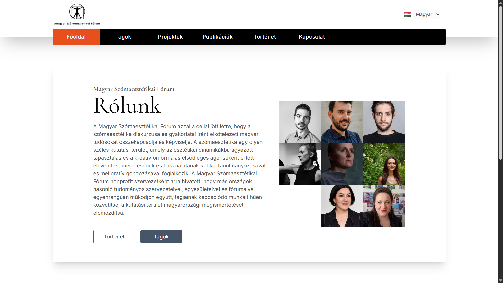
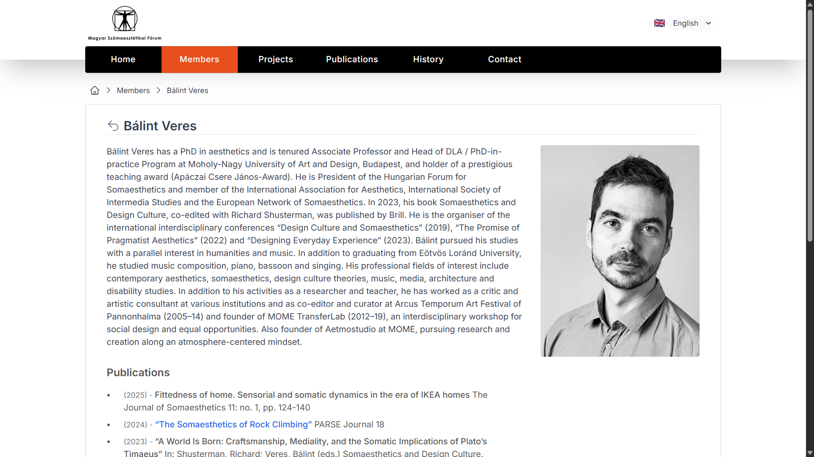
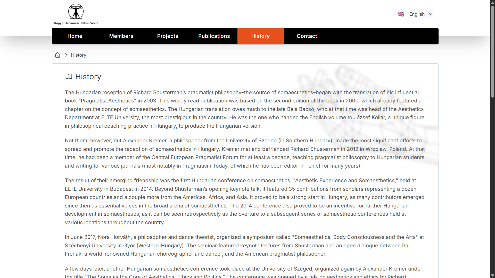

# 🇭🇺 Magyar Szómaesztétikai Fórum

## 🇬🇧 Hungarian Forum for Somaesthetics

A **Magyar Szómaesztétikai Fórum** hivatalos weboldala, amely a szómaesztétikai kutatások, események, publikációk és közösségi tagok bemutatását szolgálja.

A platform célja egy strukturált és átlátható felület biztosítása a látogatók számára, ahol megismerhetik a közösség tevékenységeit és aktuális eseményeit.

---

## 🌐 Live Website

👉 https://somaesthetics.hu

---

## 📸 Preview

---

## ✨ Features

* Többnyelvű felület (HU / EN)
* Események és publikációk megjelenítése
* Tagok és közösségi információk
* Reszponzív design
* Modern, letisztult UI

---

## ⚙️ Tech Stack

* Next.js
* TypeScript
* Tailwind CSS
* next-intl

---

## 🧠 Key Learnings

* Next.js App Router használata
* Nemzetköziesítés (i18n) implementálása
* Komponens-alapú architektúra
* Skálázható frontend struktúra

